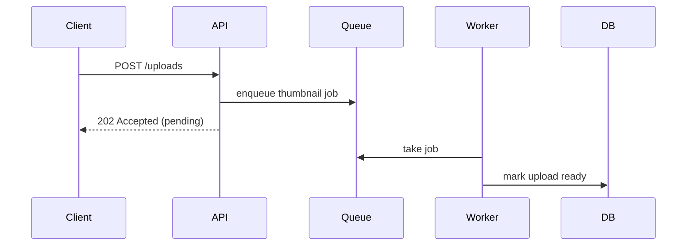

# Create PR Skill

Automate the end-to-end process of creating a GitHub pull request from local changes.

## Workflow Overview

1. Assess the current state (branch, staged/unstaged changes, commits)
2. Create a branch if on the default branch
3. Run improve-english skill to fix English quality in the changes
4. Check documentation consistency with the code changes
5. Stage and commit changes
6. Determine push target (fork vs origin)
7. Check diff size and split into multiple PRs if needed
8. Run tests and linters
9. Push and create the PR

## Step 1: Assess Current State

Run these in parallel:

- `git status` (never use `-uall`)
- `git diff` and `git diff --cached`
- `git branch --show-current`
- `git remote -v`
- `git log --oneline -10`

Determine:

- Are there uncommitted changes? Unstaged files?
- Which branch are we on? Is it the default branch (main/master)?
- What remotes exist?

## Step 2: Branch Creation

If on the default branch, create a new branch before making any changes.

Branch naming format: `YYYY.MM.DD-<descriptive-topic>`

- Use today's date
- Use lowercase kebab-case for the topic
- Example: `2026.03.07-fix-auth-token-refresh`

Ask the user what the topic should be if it's not obvious from context.

## Step 3: Run improve-english

Before committing, invoke the `improve-english` skill to fix spelling errors in
identifiers, improve comment English, and translate any Japanese comments. Show the
proposed changes to the user and ask for confirmation before applying. This step
catches English issues early so the PR is clean from the start.

## Step 4: Check Documentation Consistency

Before committing, verify that the code changes do not contradict any documentation
in the repository. Documentation that silently drifts from the code is worse than no
documentation, so treat a found inconsistency as a blocker, not a nice-to-have.

1. Collect the changed files and the diff content (`git diff` / `git diff --cached`
   against the merge base with the default branch).
2. Find documentation that may reference the changed code:
   - `README.md` (root and in changed directories), `CLAUDE.md`, `CONTRIBUTING.md`
   - Everything under `docs/` and any other tracked `*.md` files
   - Grep the docs for identifiers touched by the diff: renamed/removed functions,
     classes, CLI commands and flags, environment variables, config keys, file
     paths, API endpoints, and default values.
3. Compare what the docs claim against what the code now does. Typical
   inconsistencies to catch:
   - Usage examples or sample commands that no longer work
   - Option/flag/env-var names or defaults that changed
   - Described behavior, workflow steps, or directory layouts that changed
   - Docs referencing files that were moved or deleted
4. If inconsistencies are found, show the user a short list of
   `doc file -> what is stale -> proposed fix` and, with their approval, update the
   documentation in the same branch so the docs land in the same PR as the code.
5. If the docs are fine, state that explicitly and move on.

Skip files that are intentionally template-like (e.g. anything under a `templates/`
directory) — placeholders there are expected to look "wrong".

## Step 5: Stage and Commit

Never use `git add .` or `git add -A`. Always specify files explicitly.

Review the changes and group them logically. Write commit messages in English that focus on
the "why" behind the changes, not just what changed.

## Step 6: Determine Push Target

Check the GitHub repository owner to decide where to push:

- Run `gh repo view --json owner -q '.owner.login'` to get the repo owner
- If the owner is `garaemon`, push to `origin`
- Otherwise, check if a fork exists with `gh repo list garaemon --json name,nameWithOwner`
  or `gh repo view garaemon/<repo-name>` and push to the fork

When pushing, always set the upstream tracking branch:

```bash
git push -u <remote> <branch>
```

If a fork doesn't exist yet, create one with `gh repo fork --remote-name fork` and push to it.

## Step 7: Check Diff Size and Split if Needed

This is important: PRs should be small and focused, ideally around 100 lines of diff.

After staging all intended changes, check the total diff size:

```bash
git diff --cached --stat
git diff --cached | wc -l
```

If the diff exceeds ~100 lines, split it into multiple PRs by functionality:

1. Analyze the changes and group them by feature/concern
2. Present the proposed split to the user for approval
3. For each group:
   - Create a separate branch from the base
   - Cherry-pick or stage only the relevant files
   - Create a separate PR
4. If changes have dependencies, note this in each PR description

Ask the user before splitting. They may prefer a single larger PR in some cases.

## Step 8: Run Tests and Linters

Before creating the PR, always run tests and linters. Find the right commands by checking:

1. `README.md` for test/lint instructions
2. `.github/workflows/` for CI configuration
3. `Makefile`, `package.json`, `Cargo.toml`, `pyproject.toml`, etc.

If tests or linters fail, fix the issues before proceeding. Do not skip this step.

## Step 9: Create the PR

Write the PR body as a cover note for the reviewer. It is not a changelog, a
validation log, or a file-by-file summary. Write it in English, and follow the
`technical-writing` skill.

The body shape and reviewer aids below come from Sentry's `pr-writer` skill:
<https://github.com/getsentry/skills/blob/main/skills/pr-writer/SKILL.md>

### Gather the context

Read the whole branch diff against the base branch, not only the latest commit:

```bash
git log "$BASE"..HEAD --oneline
git diff "$BASE"...HEAD
```

Then answer two questions:

- What behavior changes, and who notices it?
- Why is the change needed now?

If the "why" is not clear from the code, the commits, or the conversation,
ask the user. Never invent a motivation, an issue number, or a benchmark.

### Write the title

- Write one imperative sentence that names the dominant change, such as
  "Fix null handling in format_string and parse_int".
- Avoid vague titles such as "Update", "Cleanup", "Fix bug", or
  "Address feedback".
- Do not end the title with a period.

### Pick the smallest body shape

Choose the shape from the kind of change:

| Change | Body |
| --- | --- |
| Small or obvious | One gist sentence, plus a short bulleted list if there are two or more changes. No headings. |
| Bug fix | The gist, then bullets for the symptom, the root cause, and the fix. |
| Feature or refactor | The gist, a bulleted list of the behavior changes, then the non-obvious approach or trade-off. Add a diagram when components or steps interact. |
| Breaking change | The affected API, config, or CLI surface, a before/after snippet, and numbered migration steps. |
| Broad or generated change | Why the breadth is necessary, and a numbered review order. |

The default body is a gist sentence followed by bullets:

```markdown
<One sentence: what changed and what effect it has.>

- <Behavior change 1>
- <Behavior change 2>

<Why this approach, the risk, or what the reviewer should focus on, as bullets
or one short paragraph.>
```

Make the body easy to scan. Reviewers skim, so prefer structure over prose:

- Put the gist in the first sentence. A reviewer who reads only that sentence
  should know what the PR does.
- Keep every sentence short: one idea per sentence, and about 20 words or
  fewer. Split a sentence that joins clauses with "and", "which", or a
  semicolon.
- Keep each bullet to one line when possible, and never more than two
  sentences.
- Default to bulleted lists. Write a paragraph only for a single connected
  argument, and keep it to three sentences or fewer.
- Use a bulleted list for two or more parallel items, such as changed
  behaviors, reasons, or risks.
- Use a numbered list for ordered steps, such as migration steps, a review
  order, or a sequence of events.
- Use a table to compare options, or to map inputs to outputs.
- Add headings when the body has two or more distinct topics that a reviewer
  will want to jump between. Make each heading a descriptive phrase, never a
  generic label such as "Why", "What", "Summary", "Changes", or "Test Plan".

### Add diagrams and other reviewer aids

Look for a chance to show the change instead of describing it. Add an aid
whenever it lets the reviewer grasp the change faster than prose would:

- A Mermaid diagram for any change that touches how components, processes, or
  states interact:
  - `flowchart` for control flow, data flow, or a new pipeline stage.
  - `sequenceDiagram` for a request, async flow, or message exchange.
  - `stateDiagram-v2` for a state transition.
- A before/after snippet or table for a changed output, payload, schema,
  config, or CLI.
- A directory tree for a moved or reorganized layout.
- A screenshot for a visual change.
- A review-order list for a broad PR.

Keep each diagram small: ten nodes or fewer, labeled with the names used in
the code. Introduce each aid with one sentence that says what to notice in it.
Skip the aid only when the change is a one-line fix or a pure rename.

### Leave these out

- A `Test Plan` or validation section for routine checks. Mention testing only
  when it changes the risk, such as a manual check of a case that CI cannot
  cover.
- Pasted command output, CI logs, or commit lists.
- File-by-file narration. The diff already shows the files.
- Empty headings and placeholders.
- The history of the review. Describe the PR as it stands now.

If the repository has a PR template, fill in its headings and keep the text
under each heading as short as the rules above require.

### Create the PR

Write the body to a temporary file, then pass it with `--body-file`:

```bash
gh pr create --title "Fix null handling in format_string and parse_int" \
  --body-file /tmp/pr-body.md
```

A bug fix body looks like this:

```markdown
`format_string` and `parse_int` no longer crash when they receive `None`.

- **Symptom:** requests with a missing optional field fail with intermittent
  `AttributeError` and `TypeError` in the request pipeline.
- **Root cause:** both helpers run on every request, but neither guards
  against `None`.
- **Fix:** `format_string` now returns `""`, and `parse_int` returns `None`.

Generated with [Claude Code](https://claude.com/claude-code)
```

A feature body with a diagram looks like this:

````markdown
Uploads now go through a background worker, so the upload endpoint returns
before the thumbnail is ready.

- `POST /uploads` stores the file and enqueues a `thumbnail` job.
- The worker generates the thumbnail and marks the upload `ready`.
- Clients poll `GET /uploads/:id` until the status is `ready`.

The sequence below shows where the request now returns early:



Focus the review on the retry handling in `worker.py`. A failed job retries
three times, then marks the upload `failed`.

Generated with [Claude Code](https://claude.com/claude-code)
````

After creating the PR, display the PR URL to the user.

### Refresh the description after follow-up commits

When later commits change the scope, the approach, or the risk, rewrite the
title and the body around the full diff. Skip the refresh for typo-only or
formatting-only commits.

## Important Rules

- Always use English for commit messages and PR descriptions
- Never use `git add .` -- specify files explicitly
- Always run tests/linters before creating the PR
- Always check markdown documentation for inconsistencies with the code changes,
  and fix stale docs in the same PR
- Always set upstream when pushing (`git push -u`)
- Keep PRs small (~100 lines); split larger changes with user approval
- Write the PR description as a short cover note for the reviewer: gist first,
  then bullets, and a diagram whenever components or steps interact; ask the
  user if the motivation is unclear
- When on the default branch, always create a new branch first
